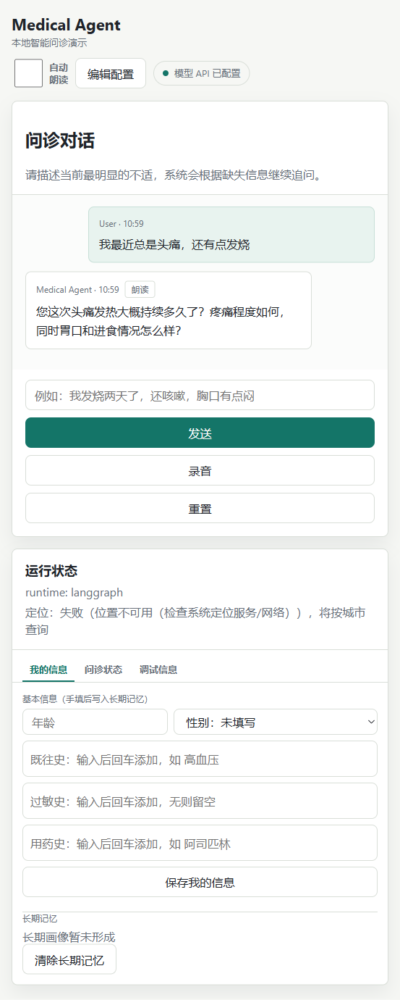
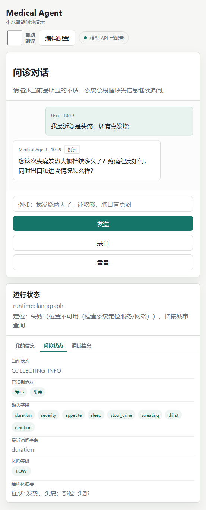

# Medical Agent

Medical Agent 是面向多轮问诊的 Agent 工程原型，提供 Flask 网页和 Electron 桌面客户端。项目围绕结构化事实抽取、会话状态、交互意图、规划与复核、知识检索和医院查询实现完整流程，并提供 LoRA/QLoRA 训练、混合评测和推理性能测量工具。它不是医疗诊断系统。

默认网页保留 DeepSeek/Mock 与规则流程；可显式启用 `qwen-grounded` 原型：Qwen3.5-4B 抽取 LoRA 负责事实抽取，基座负责意图、Planner、Reviewer 和回复生成，程序校验安全与请求权限，规则承担兜底。完整对话归档与模型上下文分开管理。

**技术栈：** Python、Flask、LangGraph、Pydantic/JSON Schema、MCP、SQLite/JSONL、Electron；模型实验使用 Qwen3.5、vLLM、PyTorch、Transformers、PEFT 和 bitsandbytes。GPU 训练与推理环境需要单独准备。

## 对话示例

下面保留早期网页版的一次 DeepSeek 问诊演示（5 轮结束），用于展示对话与状态栏布局；不是最新桌面客户端截图，也不代表经验证的医学诊断：

左侧为问诊对话（摘录：开场主诉与追问、最终建议，中间追问轮省略），右侧为运行状态栏（已识别症状、缺失字段、风险等级、LLM 调用指标与执行轨迹实时展示）。最终建议末尾附 RAG 检索注入的「知识库参考」段（参考方剂 + 知识库版本行）与安全边界说明：

| 问诊对话 | 运行状态 |
| --- | --- |
|  |  |

## 快速开始

### Windows 一键安装

双击运行：

```bat
install.bat
```

安装脚本会创建 `.venv` 虚拟环境，并安装 `requirements.txt` 中的依赖。

### 启动网页

双击运行：

```bat
start.bat
```

或在命令行运行：

```bash
python start.py
```

启动后浏览器会打开：

```text
http://localhost:5000
```

如果浏览器没有自动打开，可以手动访问上面的地址。命令行使用安装后的虚拟环境 Python；Windows 可先执行 `.\.venv\Scripts\Activate.ps1`。

### 启动 Windows 桌面客户端

桌面客户端是依赖现有 Python 工程的 L2 原型，需要工程根目录已存在 `.venv/Scripts/python.exe`，并安装 Node.js/npm：

```powershell
cd desktop
npm ci
# 无模型服务时先体验规则/Mock 流程
npm start -- --project .. --mode rule
# 基座与抽取 LoRA 服务就绪后使用完整 Qwen 流程
npm start -- --project .. --mode qwen-grounded
```

客户端提供会话列表、文字问诊、运行状态和历史恢复；管理自己的本地 Python 后端与独立数据目录。`qwen-grounded` 的模型路由见“配置文件”。两种模式分别使用独立工作区，不会自动导入项目的云 API 密钥。

当前客户端依赖工程与 Python 环境，并非包含模型和 Python 的独立安装包。文字交互是主要入口；网页语音与浏览器定位不能视为桌面版已支持的能力。

## 首次配置 API

第一次启动时，如果项目根目录还没有 `config.env` 或没有 API Key，网页会先显示配置界面。

你可以选择：

- `DeepSeek`：填写 DeepSeek API URL、API Key、模型名等配置
- `Mock 演示模式`：不调用外部模型，只体验本地流程

点击“保存并开始”后，配置会写入本地 `config.env`。API Key 不会在网页里明文回显。

此页面配置的是默认网页 provider。多角色 Qwen 模式另由 [运行配置](agent/runtime_profiles.py) 和 [角色路由](llm/semantic_roles.qwen_prototype.yaml) 控制；选择 DeepSeek 或 Mock 不等于启用 Qwen Planner/Reviewer。

## 语音输入与朗读（可选）

在「编辑配置」面板填入 DashScope API Key（阿里云百炼）后，网页获得语音能力：

- **语音输入**：输入区「录音」按钮，点击开始录音（最长 60 秒），再次点击结束并转写为文字填入输入框，确认后再发送
- **回复朗读**：每条助手回复带「朗读」按钮；顶栏「自动朗读」开关开启后新回复自动播放（历史回放不播）
- 朗读音色可在配置面板选择（龙婉/龙小淳等 CosyVoice 音色）；长回复自动按句分段合成

未配置 key 时语音入口保留但点击提示未配置，不影响文字问诊。语音调用走百炼 OpenAI 兼容端点（Paraformer 识别 + CosyVoice 合成），本项目服务端音频处理在内存中完成、不主动保存音频文件；每次调用写入 `logs/events.jsonl` 的 `voice_call` 事件。

## 常用命令

启动网页但不自动打开浏览器：

```bash
python start.py --no-browser
```

指定端口启动：

```bash
python start.py --port 5050
```

运行系统检查：

```bash
python test_system.py
```

运行评测集（回放 15 个带标注的多轮对话剧本，默认 Mock 模式保证确定性）：

```bash
python evaluation/run_eval.py
```

只跑单个用例或查看每轮明细：

```bash
python evaluation/run_eval.py --case 04_wind_cold_full_path --verbose
```

用真实 LLM 手动跑评测（输出非确定，仅供参考，不计入 CI 基线）：

```bash
python evaluation/run_eval.py --provider deepseek
```

真实 LLM 联调冒烟（需先在 config.env 配好 key；未配置时直接退出，不做网络调用）：

```bash
python evaluation/smoke_real_llm.py
```

检索后端质量对比（BM25 vs TF-IDF，同一金标准集）：

```bash
python evaluation/compare_retrievers.py
```

命令行演示模式：

```bash
python main.py
```

### 多角色源码单元测试

以下命令用于公开仓库的代码回归，不需要模型 API 或 GPU。请在工程根目录运行；`-t .` 保留包导入路径：

```powershell
python -m unittest discover -s llm -t . -p "test_*.py"
python -m unittest discover -s memory -t . -p "test_*.py"
python -m unittest discover -s agent -t . -p "test_*.py"
python -m unittest discover -s evaluation -t . -p "test_*.py"
python -m unittest discover -s training -t . -p "test_*.py"
python -m unittest discover -s inference -t . -p "test_*.py"
python -m unittest discover -s desktop -t . -p "test_*.py"
node --test desktop/test_ui.cjs desktop/test_recovery.cjs agent/test_chat_stream.cjs
```

Windows 上另可运行 `node --test desktop/test_lifecycle.cjs`，该测试会启动本地 Mock 后端，需要已安装依赖的 `.venv`。CI 将通用测试与 Windows 后端生命周期测试分别执行；这些测试不代替真实 GPU、地图外联或临床验证。

### 训练与推理工具

先查看参数，以下命令不会启动训练或下载：

```powershell
python -m training.semantic_lora_trainer --help
python -m inference.benchmark_vllm --help
python -m inference.modelscope_download_worker --help
```

训练需另行准备 GPU 环境、已审核数据和与数据签名匹配的 release。推理基准需自备模型服务及固定 workload；权重、adapter 和本地实验数据不随仓库分发。

## 配置文件

网页配置会生成：

```text
config.env
```

示例字段：

```env
LLM_PROVIDER=deepseek
DEEPSEEK_API_URL=https://api.deepseek.com/v1/chat/completions
DEEPSEEK_API_KEY=your_deepseek_api_key
DEEPSEEK_MODEL=deepseek-chat
DEEPSEEK_MAX_TOKENS=1024
DEEPSEEK_TEMPERATURE=0.2
# 可选：网页语音识别/朗读
DASHSCOPE_API_KEY=
DASHSCOPE_VOICE_URL=https://dashscope.aliyuncs.com/compatible-mode/v1
DASHSCOPE_ASR_MODEL=paraformer-v2
DASHSCOPE_TTS_VOICE=longwan
DATA_DIR=data
LOG_DIR=logs
```

真实 provider 下建议 `DEEPSEEK_MAX_TOKENS=1024`：RAG 注入后最终回复变长，512 可能截断安全边界行（见 `config.env.example` 注释）。

可选：附近医院数据源（均留空则用演示数据，功能不受影响）：

```env
# 高德地图 Web 服务 key
AMAP_API_KEY=
# 静态 JSON 数据源，优先级高于高德；仅城市级
HOSPITAL_DATA_URL=
```

注意：这两个手填键不在 web 配置页展示/管理范围内，但配置页保存时会原样保留（序列化保留非默认键）。

浏览器定位：通过 `http://localhost`（或 127.0.0.1）访问时，页面加载会请求一次定位授权；授权后高风险升级时按真实位置检索 10km 内最近 5 家医院（按直线距离排序，10km 无结果自动扩大到 20km 并在回复中标注），拒绝或不可用时静默回退城市名查询。坐标仅会话内用于医院检索，不写入长期画像；局域网 IP 的 http 访问无法使用 Geolocation API。

`config.env` 已加入 `.gitignore`，不要提交真实 API Key。可通过 `MEDICAL_AGENT_CONFIG_PATH` 指定另一份本地配置；`DATA_DIR` 和 `LOG_DIR` 分别指定数据与日志目录。

### Qwen 多角色运行配置

`qwen-grounded` 使用 [共享运行配置](agent/runtime_profiles.py) 和 [角色 YAML](llm/semantic_roles.qwen_prototype.yaml)，默认连接 `http://127.0.0.1:8000/v1/chat/completions`。远程部署时需先建立本机到模型服务的隧道：

| 角色 | 服务端模型 ID | 任务 |
| --- | --- | --- |
| extractor | `delivery-4b-full888` | 基座加载抽取 LoRA，输出带证据的事实与更新操作 |
| intent | `qwen3.5-4b` | 咨询重点与交互请求识别 |
| planner | `qwen3.5-4b` | 根据已验证请求、风险与状态提出计划 |
| reviewer | `qwen3.5-4b` | 工具执行前核验计划依据与约束 |
| responder | `qwen3.5-4b` | 根据已接纳状态、动作和工具结果生成回复 |

该 YAML 配置各角色 `temperature=0`、关闭思考。抽取 adapter 不会自动用于 Planner/Reviewer。`delivery-4b-full888` 是服务端路由名称，需加载运行者自己的对应 adapter；没有它时不能将基座请求冒充 LoRA 请求。

[scripts/serve_qwen35_4b_bf16.sh](scripts/serve_qwen35_4b_bf16.sh) 提供 WSL/Linux **基座**启动示例，内含示例虚拟环境和模型目录。它不加载抽取 adapter；完整模式还需在 vLLM 启动配置中启用 LoRA 并注册上述模型 ID。模型目录、adapter、SSH 和 API key 需自行准备。

网页也可在启动进程前显式应用同一套配置（工程根目录，已有 `config.env`）：

```powershell
python -c "import os,runpy; from pathlib import Path; from agent.runtime_profiles import qwen_grounded_settings; os.environ.update(qwen_grounded_settings(Path.cwd())); runpy.run_path('start.py',run_name='__main__')" --host 127.0.0.1 --no-browser
```

此方式要求本地配置没有覆盖这些 `AGENT_*` 选项。普通 `python start.py` 保留原网页默认流程；Electron 则用 `--mode qwen-grounded` 显式选择，管理自己的配置与目录。

### 规划、复核与失败策略

Qwen Planner 的输出包含动作、请求 ID 和状态依据；程序检查依据存在性、请求与动作关系、工具条件及安全约束。Reviewer 独立核对请求、偏好和计划，不能凭理由文本授予权限。

格式或约束错误进入修复输出流程，最多三次尝试；仍不能接纳时使用规则兜底。连接、格式、依据、预算失败与兜底分别留痕。必要安全处理可直接短路普通规划，不要求每轮调用全部模型角色。

## 数据与日志

网页运行时自动生成以下文件，默认数据和日志目录已加入 `.gitignore`：

```text
data/profiles/{user_id}.json              长期用户画像
data/sessions/rollouts/{session_id}.jsonl  完整会话消息、状态与请求事件
data/sessions/threads.sqlite3             线程索引、状态快照、消息计数和请求状态
logs/app.log                              滚动日志
logs/events.jsonl                         执行轨迹与模型/工具调用事件
```

[RolloutSessionStore](memory/rollout_store.py) 先追加并落盘 JSONL，再更新 SQLite 索引；索引恢复使用已归档事件。JSONL 保存完整原始消息，不因上下文裁剪而删除；SQLite 用于查询和恢复当前状态，不是对话全文的唯一来源。请求 ID、执行状态和终态结果用于中断恢复与重复提交防护。

**归档不等于模型上下文。** 内存对话历史默认保留最近 12 条消息，各角色另按当前原文、有效事实、属性关联、上一问句与关注对象构造输入。事实选择受条数和字节预算限制，回复模块另检查服务端 tokenizer 预算；不能将字节预算当精确 token 数，或称所有角色都读取完整历史。

事实账本保留主体、极性、时间、原文证据及来源，通过追加状态事件区分明确纠错、症状新发生和已缓解。语义/证据校验失败时保留既有状态与失败记录，不能让失败结果覆盖有效事实。有限别名与同值字段转换作为派生视图，原始抽取结果仍保留、分别评分。

桌面版在 Electron 用户数据目录下，按工程和运行模式管理独立工作区，其中保存上述数据、日志和本地配置。重启可恢复已归档会话；恢复能力不代表先前的模型抽取一定正确。

网页侧栏“执行轨迹”和 `/api/debug/trace` 用于查看当前运行的节点、风险及调用记录。

基本信息与长期记忆：侧栏“我的信息”卡片可手填年龄/性别/既往史/过敏史/用药史（病史逗号分隔），保存后写入长期画像并立即同步当前会话，风险评估与追问决策即时生效；新会话会自动用画像预填年龄/病史等空字段（恢复旧会话时已有值不覆盖）。手填属于用户权威编辑，不计入槽位历史、不触发矛盾检测；“清除长期记忆”按钮仅删除画像文件，不影响本次对话。

## 知识库与评测集

中医知识以 JSON 数据文件外置在 `knowledge/data/`，加载时做 schema 校验（必填字段、枚举值、版本号），内容调整不需要改代码：

```text
knowledge/data/syndrome_rules.json           辨证规则（16 证型，含治则方向与调理建议）
knowledge/data/term_normalization.json       口语别名 → 规范术语归一化表
knowledge/data/chief_complaint_followup.json 主诉追问优先级
knowledge/data/red_flags.json                高风险红旗信号表
knowledge/data/risk_rules.json               风险分层规则（外置，schema 校验）
knowledge/data/formulas.json                 方剂语料（44 条，与证型挂钩）
knowledge/data/health_advice.json            调护语料（32 条）
knowledge/data/faq.json                      常见问答语料（14 条）
```

三类语料共 90 条，供 RAG 检索注入：最终建议前用 BM25（零依赖自实现）按 top 证型候选与主诉检索方剂/调护/FAQ，以“知识库参考”段（含知识库版本行）注入真实 provider 的最终回复；检索失败静默跳过，Mock 路径行为不变。检索器后端可切换（BM25 / TF-IDF），`evaluation/compare_retrievers.py` 用同一金标准集对比两者命中与排名。其中 32 条（经方 20 + 药食同源调护 12）整理自开源项目 [jangviktor-web/nihaixia-app](https://github.com/jangviktor-web/nihaixia-app)（MIT License，条内 `source` 字段标注），内容为白话转述、附免责声明。

`evaluation/cases/` 下是 15 个带逐轮断言的对话剧本，覆盖高风险急诊、典型证型完整问诊、信息不足、前后矛盾、脉诊接入与拒绝、高龄风险、红旗否认豁免、风险规则命中等场景；`evaluation/run_eval.py` 回放剧本走真实 LangGraph 链路，输出通过明细与汇总指标（风险识别准确率、红旗 precision/recall、收敛轮数、replan 率）。

### 结构化抽取训练

[training/semantic_lora_trainer.py](training/semantic_lora_trainer.py) 与 [delivery_full_trainer.py](training/delivery_full_trainer.py) 提供 LoRA/QLoRA 训练、数据签名检查、优化器更新边界检查点与断点恢复。训练目标是事实含义、主体、极性、时间、属性关联和更新操作；确定的字符定位、有限归一与状态投影交给程序。咨询重点、Planner、Reviewer 是独立模块。

[teacher_data.py](training/teacher_data.py) 和 [semantic_teacher.py](training/semantic_teacher.py) 提供基于事实卡的教师生成与校验管线，默认不启动付费调用。教师输出属于训练候选，并非自动可信的 gold；实际生成和导出需准备来源族、人工审核及 holdout 保留记录。训练与验证按来源组合隔离，冻结场景及其改写不得混入训练。

GPU 环境另需 PyTorch、Transformers、PEFT、Accelerate；QLoRA 还需兼容 CUDA 的 bitsandbytes。公开仓库不包含本地训练样本、release 审核产物或 adapter；专用训练器的实验配置不能当任意数据集的通用默认值。

### Agent Eval：代码、离线 Judge 与人工校准

新增 [Harness](evaluation/harness.py)、[事实指标](evaluation/runtime_fact_metrics.py)、[轨迹检查](evaluation/trajectory_checks.py) 与 [混合评分器](evaluation/hybrid_grader.py)，把原始模型输出、程序转换、拦截/重试和最终工程行为分开评价：

1. **代码层**检查事实、属性关联、纠错/新发生/缓解、风险漏升级与误升级、偏好、允许动作集合和实际工具路径。允许多个合理动作，不按唯一回复逐字匹配。
2. **LLM-as-a-Judge** 在运行结束后按固定 [rubric](evaluation/judge_rubric_v2.md) 评价切题/下一步价值、清楚/易答、文本依据，每项 0–2 分；离线 Judge 不修改运行结果。它与在线 Reviewer 是不同角色。
3. **人工校准**使用同一 rubric，隐藏模型身份和 Judge 分数；随机样本与分歧复核分别报告维度一致率、MAE、偏好一致性及分歧类型。

流畅度和质量分不能抵消安全或事实错误；Judge 的重大提示需复核，不能自动成为 gold。多轮结果同时报告逐轮通过数和完整场景通过数，后续传播失分按根因归并。工具攻击没有实际抵达工具返回路径时标为未覆盖，不计防护通过。

原 15 个 Mock 剧本仍是公开基线；上述扩展工具需要自备符合协议的场景和运行记录。工程政策一致性、开发回归和临床准确率是不同概念。

知识库内容为**演示级**示例，需经中医专业审核后方可用于实际场景。

## 项目结构

```text
app.py                 Flask 网页入口
start.py               本地网页启动器
config_manager.py      本地配置读写和脱敏
main.py                命令行演示入口
templates/index.html   网页配置、问诊与运行状态
static/                网页样式与聊天流式传输逻辑
desktop/               Electron 客户端、后端生命周期、会话恢复与隔离
agent/                 LangGraph、交互意图、Qwen 规划/复核与安全/权限门
llm/                   多角色客户端、YAML 路由、事实契约与输出校验
memory/                事实账本、模型上下文、JSONL 归档与 SQLite 会话索引
tools/                 症状、风险、指南、知识检索工具，及工具协议与注册表
knowledge/             中医知识结构；data/ 下为外置知识数据（JSON）
mcp_bridge/            MCP 客户端桥接（配置校验/同步调用/工具适配）
mcp_servers/           仓库内 MCP 试点服务（hospital_locator 附近医院）
mcp_servers.json       MCP 服务接入配置（stdio，可选 call_timeout）
observability/         日志、JSONL 事件流与指标汇总
evaluation/            回放 Harness、事实/轨迹指标、混合评分与 Judge rubric
training/              教师数据校验、审核门、LoRA/QLoRA 训练与恢复
inference/             固定负载基准、服务端追踪、资源采样与模型下载
scripts/               已跟踪的 Qwen3.5-4B 基座启动示例
docs/                  早期架构文档与网页示例截图（历史资料）
test_system.py         系统检查脚本
```

### MCP 接入

`mcp_bridge` 把外部 MCP 服务适配为仓库统一工具协议（`{server}_{tool}` 命名、ToolResult 降级、本地参数 schema 校验）；子进程环境白名单最小化，不透传宿主全量环境。当前试点服务 `hospital_locator`（附近医院查询）：会话中抽取的城市（或 `MEDICAL_AGENT_LOCATION` 环境变量）驱动查询，高风险升级回复可附就近医院清单；数据源演示级，可配置切真实地图（见“配置文件”）。`pulse_device` 为硬件接入占位（默认禁用）。

## 当前能力

### Agent 与交互

- LangGraph 编排抽取、状态更新、意图、规划、复核、工具和回复；默认规则流程与显式 Qwen 模式并存。
- 模型抽取语义，程序校验证据与关联并更新事实账本；原始值、来源与派生视图分别保留。
- 区分咨询重点、暂停普通追问、总结、资料来源、脉诊偏好和医院查询；本轮暂停与持续暂停按明确表达处理。
- Planner 引用已验证请求/状态依据，Reviewer 在工具执行前独立核验；失败修复与规则兜底保留原因和调用代价。
- 风险检查所有相关事实，不依赖主诉排序；区分本人/他人、否认、假设和真实状态变化。安全处理优先于普通交互要求。
- MCP 工具桥接、受控检索资料、附近医院查询、异常降级和工具返回隔离；接口可切演示数据、高德或静态数据源。

### 持久化与客户端

- 完整 JSONL 会话归档、SQLite 线程/请求索引、长期画像和受预算约束的角色上下文分离。
- 网页配置、状态侧栏、执行轨迹和可选语音；Windows Electron 文字客户端支持独立工作区、会话列表与恢复。
- 聊天传输记录请求状态，处理重复提交与中断后的结果查询；客户端后端生命周期与模型上游断连分开处理。

### 训练、评测与推理测量

- 教师事实卡校验、审核后数据导出、来源组合隔离及 LoRA/QLoRA 检查点恢复。
- 原始/派生抽取指标、属性/操作指标、完整场景约束、离线 Judge 与有限人工校准。
- 普通解码、EAGLE3、DFlash 的实验比较；前缀缓存另列控制条件，不把缓存收益计为投机解码收益。
- [benchmark_vllm.py](inference/benchmark_vllm.py) 测量客户端固定负载，SSE 片段计时不能称为服务端 TTFT。
- [role_server_trace.py](inference/role_server_trace.py) 与 [server_timing_metrics.py](inference/server_timing_metrics.py) 用请求 ID 关联 ASGI/引擎事件，计算服务端 TTFT、排队、完成耗时及请求平均 TPOT；服务端记录缺失时不以客户端时钟补数。观察器针对已验证的 vLLM 0.30.0 内部接口，其他版本需先核对。
- [sample_resources.py](inference/sample_resources.py) 采样资源，[modelscope_download_worker.py](inference/modelscope_download_worker.py) 提供 Qwen 2B/9B 国内 ModelScope 下载及固定 revision/文件 SHA 校验。

### 已完成的本地开发实验

以下为 RTX 5090 D v2（24 GB）、WSL2 上的固定负载记录摘要，实验原答和数据保留在本地。公开仓库发布可复用源码，不包含这些实验的完整数据、模型与报告；CI 不验证下表成绩。

| 范围 | 普通解码 | EAGLE3 | DFlash |
| --- | --- | --- | --- |
| 完整 Qwen Planner/Reviewer Agent，并发 4：全部轮吞吐 | 20.00 轮/分钟 | 22.37 轮/分钟 | 27.54 轮/分钟 |
| 同组完整轮耗时 p95 | 22.55 s | 17.75 s | 14.69 s |
| 同组工程通过：轮 / 完整场景 | 55/60、20/24 | 56/60、20/24 | 56/60、20/24 |
| 真实角色固定负载，并发 4：服务端聚合输出吞吐 | 255.78 token/s | 279.98 token/s | 366.16 token/s |
| 同负载：请求平均 TPOT 的均值 | 12.79 ms | 12.65 ms | 9.96 ms |
| 同负载：服务端 TTFT p95 | 246.07 ms | 303.15 ms | 309.84 ms |

完整 Agent 采用 24 个已用于开发的多轮场景，每组 60 轮，单次回放；原成绩对应当时冻结版本，后续安全修复另作回归，不覆盖旧结果。角色基准采用 25 个真实角色输入、每角色 5 个，并发 1/4 各重复两遍；五角色均覆盖，热身另计。两类实验均关闭跨请求前缀缓存，FlashAttention2 是共同基线。

DFlash 在该完整流程中并发 4 吞吐提高约 37.7%；角色负载吞吐提高约 43.2%，但 TTFT 增大，短回复角色也不一定更快。完整 Agent 的调用次数、输出长度与重试有差异，不能把全部变化归因于解码算法；工程接纳数不等于纯模型准确率、逐 token 等价或临床准确率。

服务端 TTFT 从 ASGI 接收请求到首个输出 token 批次就绪，包含 API 准备和排队；请求平均 TPOT 按首末输出时点与实际 token 数计算，不是逐 token 间隔分位数。完整 Agent 首次可见回复时间、模型服务 TTFT 和节点 TPOT 分别报告，不混用。

## 注意

本项目仅用于工程原型和演示，不替代医生面诊、诊断或治疗建议。高风险症状应及时就医。

- 默认启动不会自动选择实验性能最好的配置。模型、adapter、工具凭据与运行模式需要显式配置，常规抽取/规划效果仍有已知不足。
- API 密钥、真实会话、个人资料和训练产物保存在本地；发布时检查目录与忽略规则。
- 本地审核页面、计划/简历文档、生成数据、实验报告、检查点、模型权重和客户端二进制不纳入源码提交。
- 现有 `docs/PROJECT_ARCHITECTURE.md` 与演示图片为早期资料；当前入口、角色配置和存储方式以本文及代码为准。
